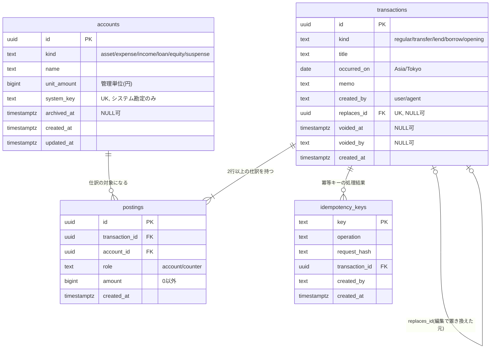

# 家計簿のデータモデル(詳細設計)

> ステータス: **確定版**(Issue #2 / フェーズ1)
> 最終更新: 2026-11-04
> 関連: [`spec.md` §3.3・§5](../spec.md)、ADR [0004](../adr/0004-double-entry-bookkeeping.md)・[0010](../adr/0010-finance-journal-rules.md)・[0011](../adr/0011-finance-needs-review.md)・[0012](../adr/0012-finance-immutability-and-idempotency.md)・[0013](../adr/0013-finance-table-details.md)

この文書は、家計簿モジュール(`finance` スキーマ)のテーブル、制約、仕訳の変換規則、集計の方針、フェーズ4で書くテストの一覧をまとめたものである。フェーズ4の実装とテストは、この文書を正とする。

---

## 0. 決まったこと(要約)

| # | 論点 | 決定 | ADR |
|---|---|---|---|
| 1 | 移動の金額の符号 | **移動元から見た符号で入力する**(現行どおり)。`-1000` は「移動元から1000出ていく」、`+1000` は「移動先から移動元へ1000入る」 | 0010 |
| 2 | 収入ラベルの扱い | ラベルに**種別(支出 `expense` / 収入 `income`)を持たせる**。金額の符号は自由(支出ラベルに `+` = 返金) | 0010 |
| 3 | 貸し借りの勘定 | **相手ごとに1つの勘定(`loan`)**。残高が正なら貸している、負なら借りている | 0010 |
| 4 | 精算の入力 | **同じラベル+符号で表す**。「貸す」の `+x` は回収、「借りる」の `-x` は返済 | 0010 |
| 5 | 要確認の取引 | **保存する**。ラベル・相手・移動先がないときは、仕訳の相手側を「未分類」勘定にする | 0011 |
| 6 | ルール4の判定単位 | 累計残高が**管理単位の倍数でなくなった取引**を要確認にする | 0011 |
| 7 | 編集・削除 | **取消フラグ+置き換え**。仕訳の行は一度書いたら変えない | 0012 |
| 8 | 冪等キーの重複 | 同じ内容なら最初の結果を返し、**内容が違えばエラー(409)** | 0012 |
| 9 | IDの型 | **UUIDv7** | 0013 |
| 10 | 残高の求め方 | **基準日(今日)を引数で渡す集計クエリ**。残高テーブルは持たない | 0013 |
| 11 | 取引の種別 | **取引に種別(`kind`)を保存する** | 0013 |
| 12 | 開始残高 | **1つの取引にまとめ、有効なものは1件だけ**(DBで保証) | 0013 |

---

## 1. 用語

| 用語 | 意味 |
|---|---|
| 取引(transaction) | 画面で1回入力したもの。1つの取引は2行以上の仕訳を持つ |
| 仕訳(posting) | 「どの勘定が、いくら増減したか」の1行。**同じ取引の仕訳の合計は必ず0** |
| 勘定(account) | お金の置き場所や分類。口座・ラベル・相手・開始残高・未分類のすべてが勘定である |
| 口座 | 種別が `asset` の勘定(現金、電子マネーなど) |
| ラベル | 種別が `expense`(支出)または `income`(収入)の勘定(食費など)。画面の「貸す」「借りる」はラベルではなく取引の種別(§4) |
| 相手 | 種別が `loan` の勘定。貸し借りの相手1人につき1つ |
| 有効な取引 | 取消されていない(`voided_at IS NULL`)取引 |
| 確定 / 予定 | 取引日が基準日(今日)以前なら確定、より後なら予定。**状態として保存せず、日付から導出する** |
| 要確認 | 入力チェック(spec §3.3.1)に違反している取引。**保存せず、毎回導出する** |
| 基準日 | 「今日」。アプリが Asia/Tokyo の日付として求め、クエリに引数で渡す |

### 符号の約束
- 仕訳の金額は「その勘定の残高がどれだけ増えたか」を表す。口座に1000入れば `+1000`。
- **画面の入力金額は、取引の「口座」側の仕訳の金額と同じ**(支出は `-`、収入は `+`)。どの種別でもこの約束は変わらない。
- 相手側の仕訳は、入力金額の符号を反転したものになる。

---

## 2. ER図



---

## 3. テーブル定義(`finance` スキーマ)

共通の約束:
- 主キーは UUIDv7(時刻順に並ぶUUID)。アプリで生成して渡す。DB側の既定値は PostgreSQL 18 の `uuidv7()` を使う(PostgreSQL は 18 に決まった。ADR 0022)。
- 日時は `timestamptz`(UTCで保存)。取引日だけは `date`(Asia/Tokyo の日付)。
- 金額は `bigint`(円)。浮動小数点型は使わない。
- 外部キーはすべて `ON DELETE RESTRICT`(物理削除しないため、連鎖削除は使わない)。

### 3.1 `accounts`(勘定)

| 列 | 型 | NULL | 既定値 | 説明 |
|---|---|---|---|---|
| `id` | `uuid` | 不可 | `uuidv7()` | 主キー |
| `kind` | `text` | 不可 | | 勘定の種別(下表) |
| `name` | `text` | 不可 | | 表示名。`loan` は相手の名前 |
| `unit_amount` | `bigint` | 不可 | `1` | 管理単位(円)。`asset` 以外は常に1 |
| `system_key` | `text` | 可 | `NULL` | システム勘定の識別子(`opening_balance` / `uncategorized`) |
| `archived_at` | `timestamptz` | 可 | `NULL` | アーカイブした日時。削除の代わり |
| `created_at` | `timestamptz` | 不可 | `now()` | |
| `updated_at` | `timestamptz` | 不可 | `now()` | 名前・管理単位・アーカイブの変更時に更新 |

| `kind` | 意味 | 作る人 |
|---|---|---|
| `asset` | 口座 | 利用者(画面) |
| `expense` | 支出のラベル | 利用者(画面) |
| `income` | 収入のラベル | 利用者(画面) |
| `loan` | 貸し借りの相手(正=貸し、負=借り) | 利用者 |
| `equity` | 純資産:開始残高 | マイグレーション(1件だけ) |
| `suspense` | 未分類(ラベル・相手・移動先がない取引の受け皿) | マイグレーション(1件だけ) |

制約:
- `PRIMARY KEY (id)`
- `UNIQUE (kind, name)` — 同じ種別の中で名前は重複しない(支出の「その他」と収入の「その他」は共存できる)
- `UNIQUE (system_key)`
- `CHECK (kind IN ('asset','expense','income','loan','equity','suspense'))`
- `CHECK (btrim(name) <> '')`
- `CHECK (unit_amount >= 1)`
- `CHECK (kind = 'asset' OR unit_amount = 1)`
- `CHECK ((kind IN ('equity','suspense')) = (system_key IS NOT NULL))` — 純資産と未分類はシステム勘定だけ
- `CHECK (system_key IS NULL OR system_key IN ('opening_balance','uncategorized'))`
- トリガー: `kind`・`system_key` の変更を禁止。`DELETE`・`TRUNCATE` を禁止。

システム勘定2件(`開始残高`・`未分類`)はマイグレーションで作る。実在の口座名・ラベル名はシードに含めない(spec §3.3.2)。

### 3.2 `transactions`(取引)

| 列 | 型 | NULL | 既定値 | 説明 |
|---|---|---|---|---|
| `id` | `uuid` | 不可 | `uuidv7()` | 主キー |
| `kind` | `text` | 不可 | | 画面で何として入力したか(§4) |
| `title` | `text` | 不可 | `''` | 題名 |
| `occurred_on` | `date` | 不可 | | 取引日(Asia/Tokyo)。未来なら予定 |
| `memo` | `text` | 不可 | `''` | メモ |
| `created_by` | `text` | 不可 | | 作成元(CORE-06) |
| `replaces_id` | `uuid` | 可 | `NULL` | 編集で置き換えた元の取引 |
| `voided_at` | `timestamptz` | 可 | `NULL` | 取消した日時 |
| `voided_by` | `text` | 可 | `NULL` | 取消した作成元 |
| `created_at` | `timestamptz` | 不可 | `now()` | 登録日時。同じ日の取引の並び順にも使う |

制約:
- `PRIMARY KEY (id)`
- `FOREIGN KEY (replaces_id) REFERENCES transactions(id)`
- `UNIQUE (replaces_id)` — 1つの取引を置き換えられるのは1回だけ
- `CHECK (kind IN ('regular','transfer','lend','borrow','opening'))`
- `CHECK (created_by IN ('user','agent'))`
- `CHECK (voided_by IS NULL OR voided_by IN ('user','agent'))`
- `CHECK ((voided_at IS NULL) = (voided_by IS NULL))`
- `CHECK (replaces_id IS NULL OR replaces_id <> id)`
- 部分UNIQUEインデックス: `CREATE UNIQUE INDEX transactions_one_active_opening ON finance.transactions ((true)) WHERE kind = 'opening' AND voided_at IS NULL;` — 有効な開始残高は1件だけ
- 遅延制約トリガー: 取引には合計0の仕訳が2行以上あること(§5.2)
- トリガー: `UPDATE` は「`voided_at`・`voided_by` を NULL から値にする」ことだけ許可。ほかの列の変更と、取消の解除は禁止。`DELETE`・`TRUNCATE` を禁止。
- インデックス: `(occurred_on)`、`(voided_at)` は件数が増えてから必要に応じて追加する

spec §5.4 の案から変えた点:
- `updated_at` をなくした(取引は取消以外で変わらないため)。
- `reversal_of` を `replaces_id` に変えた(打ち消しの取引は使わないため。ADR 0012)。
- `idempotency_key` は専用テーブルに移した(取消のように取引を新しく作らない操作にも冪等キーが要るため。ADR 0012)。
- `kind` を追加した(ADR 0013)。

### 3.3 `postings`(仕訳)

| 列 | 型 | NULL | 既定値 | 説明 |
|---|---|---|---|---|
| `id` | `uuid` | 不可 | `uuidv7()` | 主キー |
| `transaction_id` | `uuid` | 不可 | | 取引 |
| `account_id` | `uuid` | 不可 | | 勘定 |
| `role` | `text` | 不可 | | `account` = 画面の「口座」側、`counter` = 相手側(ラベル・移動先・相手・開始残高) |
| `amount` | `bigint` | 不可 | | 増減額(円)。0は不可 |
| `created_at` | `timestamptz` | 不可 | `now()` | |

制約:
- `PRIMARY KEY (id)`
- `FOREIGN KEY (transaction_id) REFERENCES transactions(id)`
- `FOREIGN KEY (account_id) REFERENCES accounts(id)`
- `CHECK (role IN ('account','counter'))`
- `CHECK (amount <> 0)`
- 遅延制約トリガー: 同じ取引の仕訳の合計が0で、2行以上あること(§5.2)
- トリガー: `UPDATE`・`DELETE`・`TRUNCATE` を禁止(一度書いたら変えない)
- インデックス: `(transaction_id)`、`(account_id)`

`role` を持つ理由: 移動では「どちらが移動元か」が仕訳の金額だけではわからない(`A -1000 / B +1000` は「A→B に -1000」とも「B→A に +1000」とも読める)。`role` があれば、編集画面を入力時と同じ形で再現できる。

同じ取引に同じ勘定の仕訳が2行あってもよい(移動元=移動先の取引を要確認として保存するため。ADR 0011)。

### 3.4 `idempotency_keys`(冪等キー)

| 列 | 型 | NULL | 既定値 | 説明 |
|---|---|---|---|---|
| `key` | `text` | 不可 | | クライアントが送る冪等キー |
| `operation` | `text` | 不可 | | 操作名(`create` / `replace` / `void`) |
| `request_hash` | `text` | 不可 | | 検証後のリクエスト内容のSHA-256(16進) |
| `transaction_id` | `uuid` | 不可 | | 結果の取引(作成・置き換えなら新しい取引、取消なら取消した取引) |
| `created_by` | `text` | 不可 | | 作成元 |
| `created_at` | `timestamptz` | 不可 | `now()` | |

制約:
- `PRIMARY KEY (key)`
- `FOREIGN KEY (transaction_id) REFERENCES transactions(id)`
- `CHECK (char_length(key) BETWEEN 1 AND 255)`
- `CHECK (operation IN ('create','replace','void'))`
- `CHECK (created_by IN ('user','agent'))`
- トリガー: `UPDATE`・`DELETE`・`TRUNCATE` を禁止

### 3.5 ビュー `active_postings`(有効な仕訳)

取消された取引の仕訳を、集計から一度に外すためのビュー。**集計クエリはすべてこのビューを使う**(取消の除外条件の書き忘れを防ぐ)。

```sql
CREATE VIEW finance.active_postings AS
SELECT p.id, p.transaction_id, p.account_id, p.role, p.amount,
       t.kind AS transaction_kind, t.occurred_on, t.created_at AS transaction_created_at
FROM finance.postings p
JOIN finance.transactions t ON t.id = p.transaction_id
WHERE t.voided_at IS NULL;
```

---

## 4. 画面入力から仕訳への変換規則(spec §5.3 の確定版)

### 4.1 取引の種別と入力項目

| 種別 `kind` | 画面上の操作 | 入力 | 「口座」側(`account`) | 相手側(`counter`) |
|---|---|---|---|---|
| `regular` | 支出・収入 | 題名、日付、口座、金額 x、ラベル | 口座 | ラベル(`expense`/`income`)。なければ未分類 |
| `transfer` | 口座間の移動 | 題名、日付、移動元、金額 x、移動先 | 移動元 | 移動先(`asset`)。なければ未分類 |
| `lend` | ラベル「貸す」 | 題名、日付、口座、金額 x、相手 | 口座 | 相手(`loan`)。なければ未分類 |
| `borrow` | ラベル「借りる」 | 題名、日付、口座、金額 x、相手 | 口座 | 相手(`loan`)。なければ未分類 |
| `opening` | 開始残高 | 開始日付、口座ごとの残高、相手ごとの未精算額 | 各口座・各相手 | 純資産:開始残高 |

### 4.2 変換の公式

**`opening` 以外の4種別はすべて同じ公式で変換する。**

```
口座側   : amount = x
相手側   : amount = -x
```

`lend` と `borrow` の仕訳は同じ形になる(違いは `kind` に残る)。

**`opening`** は次のとおり。
```
各口座 i : amount = 口座 i の残高 b_i         (b_i = 0 の口座は仕訳を作らない)
各相手 j : amount = 相手 j の未精算額 l_j     (貸しは正、借りは負。0 の相手は仕訳を作らない)
開始残高 : amount = -(Σb_i + Σl_j)            (合計が0のときは仕訳を作らない)
```
仕訳が2行未満になる入力(すべて0など)はエラーにする。

### 4.3 変換表(フェーズ4のテストの元になる表)

例の勘定名はすべて架空。「現金」「電子マネー」は `asset`、「食費」は `expense`、「お小遣い」は `income`、「Aさん」は `loan`。

| # | 操作 | 画面入力 | 仕訳(口座側 / 相手側) |
|---|---|---|---|
| 1 | 支出 | 現金、-800、食費 | 現金 -800 / 食費 +800 |
| 2 | 収入 | 現金、+1000、お小遣い | 現金 +1000 / お小遣い -1000 |
| 3 | 返金(支出ラベルに+) | 現金、+300、食費 | 現金 +300 / 食費 -300 |
| 4 | 収入の取り消し(収入ラベルに-) | 現金、-200、お小遣い | 現金 -200 / お小遣い +200 |
| 5 | ラベルなし(要確認) | 現金、-500、(なし) | 現金 -500 / 未分類 +500 |
| 6 | 移動 | 現金 → 移動先 電子マネー、-1000 | 現金 -1000 / 電子マネー +1000 |
| 7 | 移動(逆向きの符号) | 現金 → 移動先 電子マネー、+1000 | 現金 +1000 / 電子マネー -1000 |
| 8 | 移動先なし(要確認) | 現金 → (なし)、-1000 | 現金 -1000 / 未分類 +1000 |
| 9 | 移動元=移動先(要確認) | 現金 → 移動先 現金、-1000 | 現金 -1000 / 現金 +1000 |
| 10 | 貸す | 現金、-500、貸す、Aさん | 現金 -500 / Aさん +500 |
| 11 | 貸しの回収 | 現金、+500、貸す、Aさん | 現金 +500 / Aさん -500 |
| 12 | 借りる | 現金、+700、借りる、Aさん | 現金 +700 / Aさん -700 |
| 13 | 借りの返済 | 現金、-700、借りる、Aさん | 現金 -700 / Aさん +700 |
| 14 | 相手なし(要確認) | 現金、-500、貸す、(なし) | 現金 -500 / 未分類 +500 |
| 15 | 開始残高 | 現金 10000、電子マネー 3000、Aさん +500(貸し) | 現金 +10000、電子マネー +3000、Aさん +500 / 開始残高 -13500 |
| 16 | 開始残高(借りあり) | 現金 1000、Aさん -1000(借り) | 現金 +1000、Aさん -1000(開始残高の仕訳なし) |
| 17 | 開始残高(0の口座) | 現金 1000、電子マネー 0 | 現金 +1000 / 開始残高 -1000 |

### 4.4 変換の前に拒否する入力(保存しない)

次は「要確認」ではなく入力エラーとして拒否する。仕訳を作れないか、作っても意味をなさないもの。

- 金額がない、0、整数でない、`Number.isSafeInteger` の範囲外
- 日付がない、または存在しない日付
- 口座(移動元)がない、または `asset` 以外の勘定
- 指定された勘定が存在しない、またはアーカイブ済み(ただし置き換えで、元の取引と同じ勘定を使い続ける場合は可)
- ラベルが `expense`/`income` 以外、移動先が `asset` 以外、相手が `loan` 以外
- 開始残高: 口座が `asset` 以外、相手が `loan` 以外、同じ勘定が2回出てくる、仕訳が2行未満になる
- 開始残高: すでに有効な開始残高がある(置き換えは可。DBの部分UNIQUEでも守る)

### 4.5 取消・編集と変更履歴の取り消し

| 操作 | DBで行うこと |
|---|---|
| 登録 | 取引と仕訳を INSERT |
| 削除(取消) | 取引の `voided_at`・`voided_by` を設定。仕訳はそのまま |
| 編集(置き換え) | 1つのDBトランザクションで、元の取引を取消し、`replaces_id` = 元のID の新しい取引を INSERT |
| 変更履歴からの取り消し(CORE-04) | 登録の取り消し=取消。編集の取り消し=新しい取引を取消し、元の内容の取引を `replaces_id` = 新しい取引のID で作る。削除の取り消し=取消された内容の取引を `replaces_id` = 取消された取引のID で作る |

**取消の解除(`voided_at` を NULL に戻すこと)は行わない。** 取り消しは常に「新しい記録を足す」ことで表す。変更履歴そのものはコアモジュールの機能(spec §4.2)であり、家計簿モジュールは上の操作を公開インターフェースとして提供する。

書き込みと同じDBトランザクションで、outbox にイベント(`finance.transaction.created` / `finance.transaction.voided`)を記録する(spec §4.4。詳細はフェーズ4で設計する)。

---

## 5. DBで守るルールとアプリで守るルール

### 5.1 切り分けの方針
- **DBで守る**: 壊れると帳簿として成り立たなくなる「構造」のルール。アプリにバグがあっても、エージェントが変な入力をしても、DBが最後の砦になる。
- **アプリで守る**: 入力の意味に関わるルール(どの種別の勘定を使ってよいか、要確認の判定)。種別ごとの組み合わせが多く、ユニットテストで網羅しやすい純粋関数として書く。

| ルール | DB | アプリ | DBでの手段 |
|---|---|---|---|
| 金額は整数(円) | ○ | ○ | `bigint` 型 |
| 仕訳の金額は0以外 | ○ | ○ | `CHECK (amount <> 0)` |
| 1つの取引の仕訳の合計は0、2行以上 | ○ | ○ | 遅延制約トリガー(§5.2) |
| 参照する勘定・取引が存在する | ○ | | 外部キー |
| 種別・作成元の値が決められたものだけ | ○ | ○ | `CHECK (... IN (...))` |
| 物理削除しない | ○ | | `DELETE`・`TRUNCATE` を禁止するトリガー |
| 仕訳は書き換えない | ○ | | `UPDATE` を禁止するトリガー |
| 取引は取消以外で書き換えない、取消は解除しない | ○ | | `UPDATE` を制限するトリガー |
| 勘定の種別は変えない | ○ | | `UPDATE` を制限するトリガー |
| 冪等キーは1回だけ使える | ○ | ○ | 主キー(UNIQUE) |
| 有効な開始残高は1件だけ | ○ | ○ | 部分UNIQUEインデックス |
| 1つの取引の置き換えは1回だけ | ○ | ○ | `UNIQUE (replaces_id)` |
| 管理単位は1以上、口座以外は1 | ○ | ○ | `CHECK` |
| 種別ごとに使える勘定の種別(§4.1) | | ○ | — |
| 仕訳の `role` の数(口座側1行・相手側1行、開始残高は口座側1行以上) | | ○ | — |
| 置き換えるとき元の取引を同時に取消す | | ○ | —(結合テストで確認) |
| アーカイブ済みの勘定を新しく使わない | | ○ | — |
| 冪等キーの内容が同じか比べる | | ○ | — |
| 入力チェック(§3.3.1)の4ルール | | ○ | —(§6) |

「DBとアプリの両方」のものは、アプリでわかりやすいエラーメッセージを返すために先にチェックし、DBは最後の砦として同じことを守る。

### 5.2 仕訳合計0の遅延制約トリガー

**遅延制約(DEFERRABLE INITIALLY DEFERRED)** とは、チェックを1行ごとではなく**DBトランザクションのコミット時**に行う仕組み。仕訳は1行ずつ INSERT するので、1行目を入れた時点では合計が0にならない。コミット時にまとめて確かめれば、途中の状態を許しつつ、最終的な状態だけを守れる。

```sql
CREATE FUNCTION finance.assert_transaction_balanced() RETURNS trigger AS $$
DECLARE
  target_id uuid;
  total bigint;
  line_count integer;
BEGIN
  IF TG_TABLE_NAME = 'postings' THEN
    target_id := NEW.transaction_id;
  ELSE
    target_id := NEW.id;
  END IF;

  SELECT coalesce(sum(amount), 0), count(*) INTO total, line_count
  FROM finance.postings WHERE transaction_id = target_id;

  IF line_count < 2 OR total <> 0 THEN
    RAISE EXCEPTION 'transaction % is unbalanced (lines=%, total=%)', target_id, line_count, total
      USING ERRCODE = 'check_violation';
  END IF;
  RETURN NULL;
END;
$$ LANGUAGE plpgsql;

CREATE CONSTRAINT TRIGGER postings_balanced
  AFTER INSERT ON finance.postings
  DEFERRABLE INITIALLY DEFERRED
  FOR EACH ROW EXECUTE FUNCTION finance.assert_transaction_balanced();

-- 仕訳が1行もない取引を拒否するため、取引側にも付ける
CREATE CONSTRAINT TRIGGER transactions_have_balanced_postings
  AFTER INSERT ON finance.transactions
  DEFERRABLE INITIALLY DEFERRED
  FOR EACH ROW EXECUTE FUNCTION finance.assert_transaction_balanced();
```

仕訳は UPDATE・DELETE できないので、INSERT のときだけ確かめれば十分である。

### 5.3 物理削除・書き換えの禁止トリガー

```sql
CREATE FUNCTION finance.forbid_change() RETURNS trigger AS $$
BEGIN
  RAISE EXCEPTION '% on finance.% is not allowed', TG_OP, TG_TABLE_NAME
    USING ERRCODE = 'restrict_violation';
END;
$$ LANGUAGE plpgsql;

-- 例: postings。accounts・transactions・idempotency_keys には DELETE と TRUNCATE を同様に付ける
CREATE TRIGGER postings_no_update_delete BEFORE UPDATE OR DELETE ON finance.postings
  FOR EACH ROW EXECUTE FUNCTION finance.forbid_change();
CREATE TRIGGER postings_no_truncate BEFORE TRUNCATE ON finance.postings
  FOR EACH STATEMENT EXECUTE FUNCTION finance.forbid_change();
```

`transactions` の UPDATE は、「`OLD.voided_at IS NULL` かつ `NEW.voided_at IS NOT NULL` で、ほかの列が変わっていない」場合だけ通す専用のトリガー関数にする。`accounts` の UPDATE は、`kind`・`system_key` が変わっていなければ通す。

### 5.4 冪等キーの処理の流れ

1. 冪等キーで `idempotency_keys` を検索する。
   - あれば、`operation` と `request_hash` を比べる。同じなら、記録されている `transaction_id` の結果を返す(新しく登録しない)。違えば 409 エラー。
2. なければ、1つのDBトランザクションで「取引の書き込み+`idempotency_keys` への INSERT+outbox への記録」を行う。
3. 同じキーの同時送信で 2. の INSERT が主キー違反になったら、ロールバックして 1. からやり直す(先にコミットした方の結果が返る)。

`request_hash` は、Zodで検証した後のリクエストを、キーの順番をそろえたJSONにしてから SHA-256 を取る。

---

## 6. 入力チェック(spec §3.3.1)の判定

**4つのルールはすべてアプリで判定し、DBでは守らない。** 違反していても保存できる(ADR 0011)ため、DBの制約にすると保存そのものが拒否されてしまうからである。「要確認」は保存せず、毎回導出する。

| # | ルール | 判定する場所 | 違反の条件 |
|---|---|---|---|
| 1 | 移動先は、移動元と別の口座であること | アプリ(取引ごとの純粋関数) | `kind = 'transfer'` で、相手側が未分類(移動先なし)、または口座側と同じ勘定 |
| 2 | 移動以外の取引にはラベルが必須 | アプリ(取引ごとの純粋関数) | `kind = 'regular'` で、相手側が未分類 |
| 3 | 貸し借りには相手が必須 | アプリ(取引ごとの純粋関数) | `kind IN ('lend','borrow')` で、相手側が未分類 |
| 4 | 口座の残高が管理単位の倍数であること | アプリ(口座ごとの累計残高を見る純粋関数) | 下記 |

- ルール2の「移動以外」から、開始残高(`opening`)は除く(ラベルを持たない操作のため)。貸し借りはルール3で見る。
- ルール1は「移動先がない」場合も違反として扱う(FIN-02 で移動先の指定が必須のため)。

**ルール4の判定**: 口座(`asset`)ごとに、有効な取引の仕訳を `occurred_on`、`transaction_created_at`、`transaction_id` の順に並べて累計残高を求める(予定も含む)。**直前の累計残高が管理単位の倍数で、その取引の後の累計残高が倍数でない**とき、その取引を要確認にする。倍数でない状態が続く間の後続の取引は要確認にしない(原因の取引だけを示すため)。

- 同じ日の取引は登録順(`created_at`)に並ぶ。編集(置き換え)すると新しい取引になるため、その日の最後に移る。
- 判定に使うデータは SQL で `active_postings` から口座ごとに並べて取り出し、判定そのものは TypeScript の純粋関数で行う(ユニットテストで網羅するため)。

---

## 7. 残高・未精算額・月次集計の求め方

方針: **すべて `active_postings` からの集計クエリで求める。** 残高を別のテーブルに保存しない(仕訳と残高の二重管理を避け、予定が日付の経過で確定になる処理を不要にする)。「今日」はアプリが Asia/Tokyo で求めた日付を `$as_of` として渡す(テストで日付を固定できる)。

### 7.1 口座別の残高と総額(FIN-04・FIN-05)

```sql
SELECT a.id, a.name, a.archived_at,
       coalesce(sum(ap.amount) FILTER (WHERE ap.occurred_on <= $as_of), 0) AS confirmed_balance,
       coalesce(sum(ap.amount), 0)                                          AS projected_balance
FROM finance.accounts a
LEFT JOIN finance.active_postings ap ON ap.account_id = a.id
WHERE a.kind = 'asset'
GROUP BY a.id
ORDER BY a.name;
```

- 確定残高 = 取引日が基準日以前の仕訳の合計。予定込み残高 = すべての有効な仕訳の合計。
- 全口座の総額 = 上の結果の合計(`asset` だけ。貸し借りは含めない)。

### 7.2 相手ごとの未精算額(FIN-03)

7.1 と同じクエリを `a.kind = 'loan'` で実行し、確定・予定込みのどちらかが0でない相手だけを返す。正なら「貸している」、負なら「借りている」。両方0なら精算済み。

### 7.3 月次のラベル別集計(FIN-09「ラベル別(今月)」、`finance.monthly_summary`)

```sql
SELECT a.id, a.kind, a.name,
       -coalesce(sum(ap.amount) FILTER (WHERE ap.occurred_on <= $as_of), 0) AS confirmed_amount,
       -coalesce(sum(ap.amount), 0)                                          AS projected_amount
FROM finance.accounts a
JOIN finance.active_postings ap ON ap.account_id = a.id
WHERE a.kind IN ('expense', 'income', 'suspense')
  AND ap.occurred_on >= $month_start AND ap.occurred_on < $next_month_start
GROUP BY a.id
ORDER BY a.kind, a.name;
```

- 符号を反転して、**画面の入力と同じ向き**(支出はマイナス、収入はプラス)で返す。
- 未分類も含める(要確認の取引の金額が集計から消えないようにするため)。
- 月の範囲(`$month_start`・`$next_month_start`)はアプリが基準日から求める。

### 7.4 一覧(FIN-09)

| 一覧 | 条件 |
|---|---|
| すべての取引 | 有効な取引すべて。`occurred_on DESC, created_at DESC` |
| 今月の取引 | `occurred_on` が今月の範囲 |
| ラベル別(今月) | §7.3 |
| これからの予定 | `occurred_on > $as_of` |
| 未精算の貸し借り | §7.2 |
| 要確認 | §6 の判定で違反がある取引 |

---

## 8. 今回決めなかったこと(フェーズ4・5で確認する)

推測で埋めず、該当フェーズでオーナーに確認する。

- 貸し借りの相手を事前に登録するのか、取引の入力時に新しい名前を入れたら自動で作るのか(フェーズ5の画面設計)。
- 開始日付より前の日付の取引を許すか(現時点では制限しない)。
- 題名を必須にするか(現時点では空文字を許す。spec §3.3.1 に題名のルールはない)。
- outbox のイベントの中身(フェーズ4)。

---

## 9. フェーズ4で書くテストケースの一覧

### 9.1 ユニットテスト(Vitest、DBなし)

**仕訳の変換(§4)**
- 支出は、口座にマイナス・支出ラベルにプラスの仕訳になる
- 収入は、口座にプラス・収入ラベルにマイナスの仕訳になる
- 支出ラベルにプラスの金額を入れると、返金として支出ラベルが減る仕訳になる
- 収入ラベルにマイナスの金額を入れると、収入ラベルが減る仕訳になる
- ラベルのない支出・収入は、相手側が未分類の仕訳になる
- 移動は、移動元に入力した金額・移動先に符号を反転した金額の仕訳になる
- 移動の金額がプラスのときは、移動先から移動元へお金が入る仕訳になる
- 移動先のない移動は、相手側が未分類の仕訳になる
- 移動元と移動先が同じ移動は、同じ口座への2行の仕訳になる
- 貸すでマイナスの金額は、口座が減り相手の貸し借りの残高が増える
- 貸すでプラスの金額は、回収として口座が増え相手の貸し借りの残高が減る
- 借りるでプラスの金額は、口座が増え相手の貸し借りの残高が減る
- 借りるでマイナスの金額は、返済として口座が減り相手の貸し借りの残高が増える
- 貸すと借りるは、同じ金額なら同じ仕訳になり、種別だけが異なる
- 相手のない貸し借りは、相手側が未分類の仕訳になる
- 開始残高は、口座と相手ごとの仕訳と、合計を打ち消す開始残高の仕訳になる
- 開始残高で残高0の口座と相手は仕訳を作らない
- 開始残高の合計が0のときは、開始残高の勘定の仕訳を作らない
- 開始残高で仕訳が2行未満になる入力は拒否される
- 開始残高で同じ勘定が2回出てくる入力は拒否される
- どの種別でも、変換した仕訳の合計は0になる
- どの種別でも、口座側の仕訳の金額は画面で入力した金額と等しい
- 仕訳から編集画面の入力(種別・口座・金額・相手側)を復元できる

**入力の拒否(§4.4)**
- 金額が0の取引は拒否される
- 金額が整数でない取引は拒否される
- 金額が安全な整数の範囲を超える取引は拒否される
- 日付のない取引は拒否される
- 存在しない日付の取引は拒否される
- 口座が口座(asset)以外の勘定の取引は拒否される
- 支出・収入のラベルに支出・収入以外の勘定を指定すると拒否される
- 移動先に口座以外の勘定を指定すると拒否される
- 貸し借りの相手に相手(loan)以外の勘定を指定すると拒否される
- アーカイブ済みの勘定を使う新しい取引は拒否される
- 置き換えでは、元の取引と同じアーカイブ済みの勘定を使い続けられる

**入力チェック・要確認(§6)**
- ルール1: 移動先が移動元と別の口座なら要確認にならない
- ルール1: 移動先が移動元と同じ口座なら要確認になる
- ルール1: 移動先のない移動は要確認になる
- ルール2: ラベルのある支出・収入は要確認にならない
- ルール2: ラベルのない支出・収入は要確認になる
- ルール2: 移動・貸し借り・開始残高にはラベルを求めない
- ルール3: 相手のある貸し借りは要確認にならない
- ルール3: 相手のない貸す・借りるは要確認になる
- ルール4: 累計残高が管理単位の倍数のままなら要確認にならない
- ルール4: 累計残高が倍数でなくなった取引が要確認になる
- ルール4: 倍数でない状態が続く間の後続の取引は要確認にならない
- ルール4: 倍数に戻った後、再び倍数でなくなった取引が要確認になる
- ルール4: 管理単位が1の口座は要確認にならない
- ルール4: 同じ日の取引は登録順に累計残高を求める
- ルール4: 予定の取引も累計残高に含めて判定する
- 1つの取引が複数のルールに違反すると、違反したルールがすべて返る

**日付と集計の補助**
- 今日の日付は Asia/Tokyo で求める(UTCの15時以降は翌日になる)
- 基準日以前の取引は確定、基準日より後は予定と判定される
- 今月の範囲は、基準日の月の1日から翌月1日の前日までになる
- 12月の翌月の範囲は翌年1月になる
- 全口座の総額は口座(asset)の残高だけを合計する
- 冪等キーのリクエストのハッシュは、キーの順番が違っても同じ内容なら同じになる
- 冪等キーのリクエストのハッシュは、内容が1か所でも違えば変わる

### 9.2 結合テスト(Testcontainers の PostgreSQL)

**仕訳の合計0(遅延制約トリガー)**
- 合計が0の仕訳を持つ取引はコミットできる
- 合計が0にならない仕訳を持つ取引はコミット時に拒否される
- 仕訳が1行だけの取引はコミット時に拒否される
- 仕訳が1行もない取引はコミット時に拒否される
- 途中で合計が0でなくても、コミット時に0なら登録できる
- 登録済みの取引に後から仕訳を足して合計が崩れると拒否される

**CHECK制約・外部キー**
- 金額が0の仕訳は拒否される
- 存在しない勘定への仕訳は拒否される
- 存在しない取引への仕訳は拒否される
- 決められていない種別の勘定・取引は拒否される
- 作成元が user・agent 以外の取引は拒否される
- 口座以外の勘定に1以外の管理単位を設定すると拒否される
- 管理単位が0以下の口座は拒否される
- 同じ種別で同じ名前の勘定は登録できない
- 種別が違えば同じ名前の勘定を登録できる
- 開始残高と未分類のシステム勘定はマイグレーション後に1件ずつある
- 利用者がシステム勘定(純資産・未分類)を新しく作ることはできない
- 取消日時と取消した作成元は、片方だけ設定できない

**物理削除・書き換えの禁止**
- 仕訳は削除できない
- 仕訳は書き換えられない
- 取引は削除できない
- 勘定は削除できない
- 冪等キーの記録は削除も書き換えもできない
- 家計簿のテーブルは TRUNCATE できない
- 取引は取消日時の設定以外では書き換えられない
- 取消した取引の取消を解除することはできない
- 勘定の種別は変更できない
- 勘定の名前・管理単位の変更とアーカイブはできる

**取消・置き換え**
- 取消した取引は残高の計算から外れる
- 取消した取引と仕訳はDBに残っている
- 編集すると、元の取引が取消され、置き換え元を指す新しい取引ができる
- 1つの取引を2回置き換えることはできない
- 削除を取り消すと、取消された取引と同じ内容の新しい取引ができ、元の記録も残る
- 編集を取り消すと、編集前の内容に戻り、すべての記録が残る

**開始残高**
- 有効な開始残高は1件だけ登録できる
- 2件目の開始残高は拒否される
- 開始残高を取消すと、新しい開始残高を登録できる
- 開始残高を置き換えられる

**冪等キー**
- 同じ冪等キーで同じ内容を2回登録しても、取引は1件しか登録されない
- 同じ冪等キーで同じ内容を再送すると、最初の結果と同じ取引が返る
- 同じ冪等キーで内容が違うと、エラーになり何も登録されない
- 同じ冪等キーで同時に2回登録しても、取引は1件しか登録されない
- 取消を同じ冪等キーで再送しても、結果は変わらない
- 書き込みが失敗したときは冪等キーも記録されない

**集計クエリ(§7)**
- 確定残高には基準日以前の取引だけが含まれる
- 予定込み残高には未来の取引も含まれる
- 基準日当日の取引は確定に含まれる
- 取引のない口座の残高は0になる
- 移動は全口座の総額を変えない
- 相手ごとの未精算額は、貸しが正・借りが負になる
- 貸しと借りが同じ金額になった相手は精算済みとして一覧に出ない
- 開始残高の未精算の貸し借りが、相手の未精算額に含まれる
- 月次のラベル別集計は、支出をマイナス・収入をプラスで返す
- 月次のラベル別集計には、その月の範囲の取引だけが含まれる
- 月次のラベル別集計には未分類も含まれる
- 返金は月次集計で支出ラベルの金額を減らす
- 要確認の一覧には、違反のある有効な取引だけが出る
- 取消した取引は要確認の一覧に出ない
- これからの予定の一覧には、基準日より後の取引だけが出る

**作成元**
- 取引の作成元(user / agent)が記録される
- 取消した作成元が記録される
