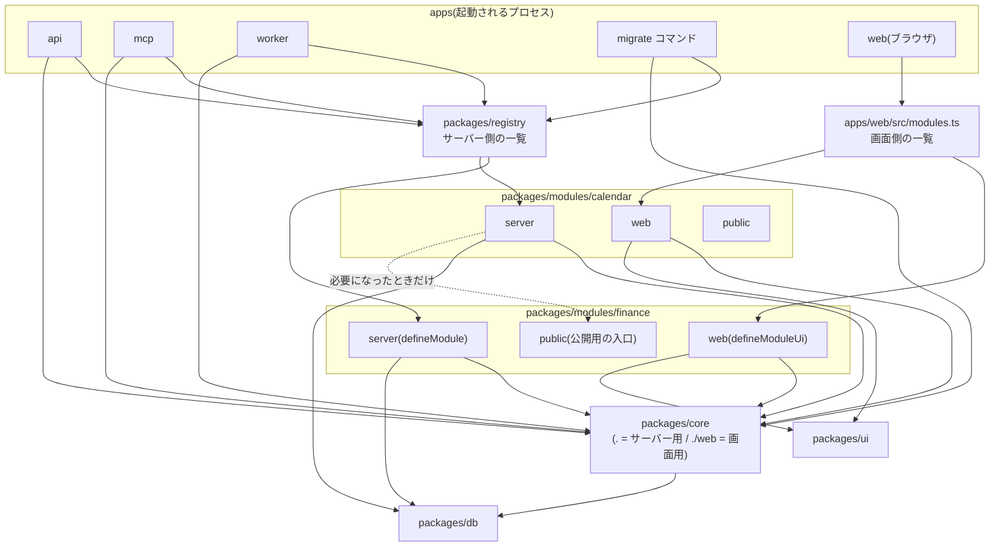

# モジュールの仕組み(詳細設計)

> ステータス: **確定版**(Issue #4 / フェーズ1)
> 最終更新: 2026-11-04
> 関連: [`spec.md` §4.2〜4.4・§6.3](../spec.md)、ADR [0001](../adr/0001-modular-monolith.md)・[0014](../adr/0014-module-manifest-and-registration.md)・[0015](../adr/0015-module-collaboration-and-boundaries.md)・[0016](../adr/0016-operations-routes-and-tools.md)、学習ノート [モジュールの登録と境界](../learning/module-registration-and-boundaries.md)

この文書は、モジュール(家計簿・カレンダーなど)をコアに登録する仕組みをまとめたものである。`defineModule` の型、各項目がコアにどう組み込まれるか、モジュール同士の連携方法、境界違反を防ぐ仕組み、テストの一覧を扱う。フェーズ2以降の実装とテストは、この文書を正とする。

---

## 0. 決まったこと(要約)

| # | 論点 | 決定 | ADR |
|---|---|---|---|
| 1 | マニフェストの数 | **サーバー用(`defineModule`)と画面用(`defineModuleUi`)に分ける**。同じ `id` で結び付ける | 0014 |
| 2 | 登録の方法 | **一覧ファイルに手で書く(静的な登録)**。サーバー側は `packages/registry`、画面側は `apps/web/src/modules.ts` | 0014 |
| 3 | 名前の衝突の防止 | **モジュールの `id` を接頭辞として強制する**(ツール・API・イベント・ジョブ・DBスキーマ)。起動時に検査する | 0014 |
| 4 | マイグレーションの実行 | **専用の `migrate` コマンドで1回だけ実行する**。`core` が先で、そのあと一覧の順。適用履歴はスキーマごとに持つ | 0014 |
| 5 | モジュール間の呼び出し | **公開用の入口(`@lifeos/<id>/public`)を直接 import する**。MVPでは読み取り専用 | 0015 |
| 6 | イベントの型 | **Zod のスキーマ+版番号**。発行時と受信時に検証する | 0015 |
| 7 | 受け手の冪等性 | コアの `core.processed_events` に「どの受け手が、どのイベントを処理済みか」を記録する | 0015 |
| 8 | 変更履歴の取り消し | 変更履歴はコアが記録し、**取り消しの処理はモジュールが登録した関数をコアが呼ぶ** | 0015 |
| 9 | 境界の検査 | **package.json の `exports`、ESLint の境界ルール、アーキテクチャテスト(dependency-cruiser ほか)**の3つ | 0015 |
| 10 | REST と MCP の関係 | **処理(操作)は共通にし、REST のルートと MCP のツールは別々の薄い入口として手で書く** | 0016 |

---

## 1. 用語

| 用語 | 意味 |
|---|---|
| コア(core) | すべてのモジュールが使う基盤(`packages/core`)。認証、イベント、ジョブ、変更履歴、監査ログ、モジュールの登録を受け持つ。**コアはモジュールを1つも知らない**(import しない) |
| モジュール | 家計簿・カレンダーのような機能のまとまり(`packages/modules/<id>`)。1つのワークスペースのパッケージ |
| マニフェスト | 「このモジュールは何を持っているか」を書いた自己紹介の定義。`defineModule`(サーバー用)と `defineModuleUi`(画面用)の2つ |
| 一覧(レジストリ) | 「どのモジュールを載せるか」を並べたファイル。サーバー側は `packages/registry`、画面側は `apps/web/src/modules.ts` |
| 操作(operation) | モジュールの処理の本体。Zod の入力スキーマと、`(ctx, call, input)` を受け取る関数の組。REST と MCP の両方から呼ばれる |
| 入口(アダプター) | 外からの呼び出しを操作につなぐ薄い層。REST のルートと MCP のツールのこと |
| 公開用の入口 | 他のモジュールが import してよい唯一のファイル(`src/public/index.ts`)。読み取り用の関数・イベントの定義・型を出す |
| `ModuleContext` | コアがモジュールに渡す道具一式(DB、イベントの発行、ジョブ、変更履歴、監査ログ、ログ、時計) |
| `CallContext` | 1回の呼び出しの情報(作成元 `user` / `agent`、リクエストID、冪等キー) |
| 完全名 | `id` を接頭辞に付けた名前。例: ツール `add_transaction` の完全名は `finance.add_transaction` |

---

## 2. 全体像

### 2.1 依存の向き

矢印は「import してよい向き」。**コアからモジュールへの矢印はない。** コアがモジュールを知らないので、モジュールを足してもコアは変わらない。



### 2.2 モジュールのディレクトリ構成

```
packages/modules/finance/
  package.json          exports は ./server ・ ./web ・ ./public の3つだけ(§5.3)
  drizzle.config.ts     schemaFilter: ["finance"]、out: "./migrations"
  migrations/           このモジュールのマイグレーション(SQL)
  src/
    domain/             純粋な業務ロジック(仕訳の変換、入力チェック)。DBもHTTPも知らない
    operations/         操作(Zodの入力スキーマ+関数)。REST と MCP の両方から呼ばれる
    db/schema.ts        Drizzle のテーブル定義。pgSchema("finance") の下にだけ作る
    server/
      index.ts          defineModule(サーバー用マニフェスト)
      routes.ts         REST のルート(Hono)
      tools.ts          MCP のツール
      listeners.ts      イベントの受け手
      jobs.ts           ジョブ
      change-handlers.ts 変更履歴の取り消し処理
    public/
      index.ts          公開用の入口(読み取り関数・イベントの定義・型)
      events.ts         defineEvent(イベントの名前・版番号・Zodスキーマ)
    web/
      index.ts          defineModuleUi(画面用マニフェスト)
      pages/            ページ(遅延読み込みされる)
```

### 2.3 一覧(レジストリ)

モジュールを載せるかどうかは、**この2つのファイルだけ**で決まる。

```ts
// packages/registry/src/server.ts
import type { AnyModuleDefinition } from "@lifeos/core";
import finance from "@lifeos/finance/server";

// 並び順はマイグレーションの適用順と、メニューの既定の並びの元になる
export const serverModules: readonly AnyModuleDefinition[] = [finance];
```

```ts
// apps/web/src/modules.ts
import type { AnyModuleUiDefinition } from "@lifeos/core/web";
import financeUi from "@lifeos/finance/web";

export const uiModules: readonly AnyModuleUiDefinition[] = [financeUi];
```

api・mcp・worker・migrate は同じ `serverModules` を読む。プロセスごとに載せるモジュールを変えることはしない。

---

## 3. `defineModule` の型(サーバー用)

型は `packages/core/src/module/` に置く。`defineModule` 自体は**値をそのまま返すだけの関数**で、型の補完と型チェックを効かせるためにある。検査(§3.5)はコアが起動時に行う。

### 3.1 コアがモジュールに渡すもの

```ts
// packages/core/src/module/context.ts
import type { Database, Tx } from "@lifeos/db";

/** 作成元(CORE-06) */
export type Actor = "user" | "agent";

/** 1回の呼び出しの情報。REST と MCP の入口がそれぞれ組み立てる */
export interface CallContext {
  actor: Actor;
  requestId: string;
  /** 書き込みのときだけ。REST は Idempotency-Key ヘッダー、MCP は入力の idempotency_key から */
  idempotencyKey?: string;
}

/** コアがモジュールに渡す道具一式。モジュールはこれ以外のコア機能に触れない(spec §4.2-3) */
export interface ModuleContext {
  /** 自分のモジュールの id。ログ・監査ログ・変更履歴に自動で付く */
  readonly moduleId: string;
  /** DB。自分のスキーマのテーブルだけを触る(§5) */
  readonly db: Database;
  /** outbox へのイベントの記録。書き込みと同じトランザクション(tx)を必ず渡す */
  readonly events: {
    emit<P>(tx: Tx, event: EventDefinition<string, P>, payload: P, call: CallContext): Promise<void>;
  };
  /** 自分のモジュールのジョブだけを積める */
  readonly jobs: {
    enqueue(jobName: string, payload: unknown): Promise<void>;
  };
  /** 変更履歴(CORE-04)。書き込みと同じトランザクションで記録する */
  readonly changes: {
    record(tx: Tx, change: ChangeInput, call: CallContext): Promise<void>;
  };
  /** 監査ログ(重要な操作。ADM-04) */
  readonly audit: {
    record(event: string, detail: Record<string, unknown>, call: CallContext): Promise<void>;
  };
  readonly logger: Logger;
  /** 「今日」は Asia/Tokyo の日付。テストで固定できるようにコアから渡す */
  readonly clock: { now(): Date; today(): string /* YYYY-MM-DD */ };
}
```

- `Database` と `Tx` は `packages/db` が出す Drizzle の型(フェーズ3で確定)。
- 通知(spec §4.2-3 の「通知」)は、フェーズ10で通知の範囲が決まったときに `ModuleContext` へ追加する。

### 3.2 マニフェストの各項目

```ts
// packages/core/src/module/define-module.ts
import type { Hono } from "hono";
import type { z } from "zod";

/** 英小文字で始まり、英小文字・数字・アンダースコアだけ。PostgreSQLのスキーマ名にもなる */
export type ModuleId = string;

export interface ModuleDefinition<Id extends ModuleId = ModuleId> {
  /** モジュールの識別子。DBスキーマ名・APIのパス・ツールとイベントの接頭辞になる */
  id: Id;
  /** 画面やエラーメッセージに出す名前 */
  displayName: string;
  /** マイグレーションのフォルダ(絶対パス) */
  migrations: { folder: string };
  /** REST API。/api/<id> の下に載る。ログイン必須のミドルウェアの内側 */
  routes?: (ctx: ModuleContext) => Hono<ApiEnv>;
  /** MCP で公開する操作。完全名は <id>.<name> */
  tools?: readonly ToolDefinition[];
  /** 発行するイベントと、受け取るイベント */
  events?: {
    emits?: readonly EventDefinition<`${Id}.${string}`, unknown>[];
    listens?: readonly EventListener[];
  };
  /** 定期実行や、後回しにする処理 */
  jobs?: readonly JobDefinition[];
  /** 変更履歴の取り消し(CORE-04)。キーは変更履歴に記録する entity の名前 */
  changeHandlers?: Readonly<Record<string, ChangeHandler>>;
}

export function defineModule<const Id extends ModuleId>(def: ModuleDefinition<Id>): ModuleDefinition<Id> {
  return def;
}
```

| 項目 | 必須 | 役割 | コアへの組み込み先 |
|---|---|---|---|
| `id` | ○ | 名前の接頭辞とDBスキーマ名 | すべて |
| `displayName` | ○ | 表示名 | エラーメッセージ、管理画面 |
| `migrations` | ○ | 自分のスキーマを作る・変えるSQL | `migrate` コマンド(§4.4) |
| `routes` | | 画面から呼ぶ REST API | `api`(§4.1) |
| `tools` | | エージェントから呼ぶ操作 | `mcp`(§4.3) |
| `events.emits` | | 自分が発行するイベントの定義 | 起動時の検査、outbox の検証(§4.5) |
| `events.listens` | | 他モジュール(または自分)のイベントの受け手 | `worker` の配送(§4.5) |
| `jobs` | | 定期実行・後回しの処理 | `worker` の BullMQ(§4.6) |
| `changeHandlers` | | 変更履歴からの取り消し処理 | `core.revert_change`(§4.7) |

`migrations` 以外は省略できる。たとえば画面とツールだけで、イベントもジョブもないモジュールも作れる。

### 3.3 ツール・イベント・ジョブ・変更履歴の型

```ts
export interface ToolDefinition<I extends z.ZodObject = z.ZodObject, O = unknown> {
  /** 完全名ではなく短い名前(例: "add_transaction")。英小文字・数字・アンダースコア */
  name: string;
  /** エージェントに見せる説明。いつ使うか・何が返るかを書く */
  description: string;
  /** 書き込みなら true。入力に idempotency_key(文字列)が必須になる(§3.5) */
  write: boolean;
  input: I;
  handler: (ctx: ModuleContext, call: CallContext, input: z.infer<I>) => Promise<O>;
}

export interface EventDefinition<Name extends string, P> {
  /** <module>.<entity>.<verb過去形>(spec §4.4) */
  name: Name;
  /** 中身の形を変えたら上げる。1から始まる整数 */
  version: number;
  payload: z.ZodType<P>;
}

/** outbox に記録され、受け手に渡される形 */
export interface EventEnvelope<P> {
  id: string;            // UUIDv7
  name: string;
  version: number;
  payload: P;
  actor: Actor;
  occurredAt: string;    // ISO 8601
}

export interface EventListener<P = unknown> {
  /** モジュール内で一意の名前。完全名 <id>.<name> で処理済みを記録する */
  name: string;
  event: EventDefinition<string, P>;
  /** tx の中で処理すると、処理済みの記録と同時にコミットされる */
  handler: (ctx: ModuleContext, tx: Tx, event: EventEnvelope<P>) => Promise<void>;
}

export interface JobDefinition<P = unknown> {
  /** 英小文字・数字・アンダースコア。キュー名は <id>.<name> */
  name: string;
  /** 定期実行なら指定する。タイムゾーンは常に Asia/Tokyo */
  schedule?: { cron: string };
  run: (ctx: ModuleContext, payload: P) => Promise<void>;
}

export interface ChangeInput {
  entity: string;        // changeHandlers のキーと一致させる(例: "transaction")
  entityId: string;
  operation: "create" | "update" | "delete" | "revert";
  summary: string;       // 変更履歴の画面とエージェントに見せる一文
}

export interface ChangeRecord extends ChangeInput {
  id: string;
  moduleId: string;
  actor: Actor;
  occurredAt: string;
}

export type ChangeHandler = {
  /** 取り消しを行う。新しい記録を足して表し、自分も changes.record する */
  revert: (ctx: ModuleContext, call: CallContext, change: ChangeRecord) => Promise<void>;
};
```

### 3.4 名前の決まり

| 対象 | モジュールが書く名前 | コアが使う完全名 | 例 |
|---|---|---|---|
| DBスキーマ | (`id` と同じ) | `<id>` | `finance` |
| REST API | `routes` の中のパス | `/api/<id>/...` | `/api/finance/transactions` |
| MCPツール | `name` | `<id>.<name>` | `finance.add_transaction` |
| イベント | 完全名で書く | `<id>.<entity>.<verb過去形>` | `finance.transaction.created` |
| イベントの受け手 | `name` | `<id>.<name>` | `calendar.on_something` |
| ジョブ | `name` | `<id>.<name>` | `calendar.refresh_tokens` |
| 画面のパス | `routes` の中のパス | `/<id>/...` | `/finance/transactions` |

イベントだけ完全名で書くのは、他のモジュールが受け手を書くときにも同じ名前を目にするので、省略しないほうが読みやすいため。代わりに、型(テンプレートリテラル型 `` `${Id}.${string}` ``)と起動時の検査で接頭辞を確かめる。

### 3.5 起動時の検査

api・mcp・worker・migrate はどれも、最初に `createModuleHost(serverModules)` を呼ぶ。ここで次を検査し、1つでも違反があれば**起動を中止する**(何が悪いかをエラーメッセージに出す)。

1. `id` が `^[a-z][a-z0-9_]*$` に合う。予約語(`core`、`public`、`api`、`auth`、`mcp`、`pg_` で始まるもの)ではない。
2. `id` が一覧の中で重複していない。
3. ツール名・受け手の名前・ジョブ名が、そのモジュールの中で重複していない。名前の形式が正しい。
4. 書き込みツール(`write: true`)の入力スキーマに `idempotency_key`(文字列)がある。
5. `events.emits` の名前がすべて `<id>.` で始まる。同じ名前・同じ版番号のイベントが2つない。
6. `events.listens` の各イベント(名前と版番号)を、一覧のどれかのモジュールが `emits` している。
7. `schedule.cron` が正しい cron 式である。
8. `routes` が返す Hono のアプリが作れる(作る途中で例外が出ない)。

`changes.record` で `changeHandlers` にない `entity` を記録しようとしたら、その場でエラーにする(実行時の検査)。

---

## 4. 登録の仕組み(それぞれがどうコアに組み込まれるか)

### 4.1 API ルート(`api` プロセス)

```ts
// apps/api/src/app.ts(イメージ)
const host = createModuleHost(serverModules);   // §3.5 の検査
const app = new Hono<ApiEnv>();
app.use("/api/*", requireSession);               // ログイン必須(フェーズ6)
app.use("/api/*", buildCallContext);             // actor: "user"、Idempotency-Key ヘッダー
app.route("/api/core", coreRoutes(host));        // 変更履歴など、コア自身のAPI
for (const m of host.modules) {
  if (m.routes) app.route(`/api/${m.id}`, m.routes(host.contextFor(m.id)));
}
```

- モジュールは `/api/<id>` より上のパスを持てない。パスの衝突は構造的に起きない。
- 認証はコアのミドルウェアが先に行うので、モジュールのルートはログイン済みを前提に書ける。
- OpenAPI の仕様書は、各モジュールのルートに付けた Zod のスキーマから生成する(生成の方法と、生成したクライアントの置き場所はフェーズ5で決める)。

### 4.2 画面のページとメニュー(`web`)

画面用のマニフェストは `@lifeos/core/web` の `defineModuleUi` で書く。このファイルはブラウザで動くので、DB や Hono を import できない(§5 の検査で止める)。

```ts
// packages/core/src/web/define-module-ui.ts
import type { AnyRoute } from "@tanstack/react-router";

export interface MenuItem {
  label: string;
  /** /<id> で始まる画面のパス */
  to: string;
  /** 小さいほど上。省略時は一覧の並び順 */
  order?: number;
  icon?: string;
}

export interface ModuleUiDefinition<Id extends string = string> {
  /** サーバー側の defineModule と同じ id */
  id: Id;
  displayName: string;
  menu: readonly MenuItem[];
  /** 親(ログイン後の画面の枠)の下にぶら下げるルートを作る。パスは /<id> で始める */
  routes: (parent: AnyRoute) => AnyRoute;
}

export function defineModuleUi<const Id extends string>(def: ModuleUiDefinition<Id>) {
  return def;
}
```

`apps/web` は一覧を順に読み、ルートとメニューを組み立てる。

```ts
// apps/web/src/router.tsx(イメージ)
const moduleRoutes = uiModules.map((m) => m.routes(appLayoutRoute));
const routeTree = rootRoute.addChildren([
  loginRoute,
  appLayoutRoute.addChildren([homeRoute, changesRoute, ...moduleRoutes]),
]);
const menu = uiModules
  .flatMap((m, i) => m.menu.map((item) => ({ ...item, order: item.order ?? i * 100 })))
  .sort((a, b) => a.order - b.order);
```

- ページは TanStack Router のコード上でのルート定義(code-based routing)と `lazyRouteComponent(() => import("./pages/..."))` で**遅延読み込み**する。家計簿の画面を開くまで、家計簿の画面のコードは読み込まれない。
- 画面用とサーバー用の一覧で `id` が食い違っていないかは、アーキテクチャテスト(§5.4)で確かめる。
- モジュールをまたぐ型付きリンク(TanStack Router の型の登録)の扱いは、フェーズ5で実装しながら決める。

### 4.3 MCP ツール(`mcp` プロセス)

```ts
// apps/mcp/src/tools.ts(イメージ)
for (const m of host.modules) {
  for (const tool of m.tools ?? []) {
    server.registerTool(`${m.id}.${tool.name}`, {
      description: tool.description,
      inputSchema: tool.input.shape,
    }, async (input) => {
      const call = { actor: "agent", requestId: newRequestId(),
                     idempotencyKey: tool.write ? input.idempotency_key : undefined };
      return toMcpResult(await tool.handler(host.contextFor(m.id), call, input));
    });
  }
}
```

- 作成元は必ず `agent` になる(CORE-06)。モジュールが自分で決めることはない。
- コア自身のツール(`core.list_changes` / `core.revert_change`)も、同じ形でコアが登録する。
- ツール名に `.` を使えるかは、フェーズ8で準拠するMCP仕様を決めるときに確認する。使えない場合は区切り文字だけを変える(完全名を作るのはコアの1か所だけなので、モジュールは変わらない)。

### 4.4 マイグレーション(`migrate` コマンド)

- 各モジュールは自分の `drizzle.config.ts` を持ち、`schemaFilter: ["<id>"]` で**自分のスキーマだけ**を対象にマイグレーションを生成する。最初のマイグレーションで `CREATE SCHEMA <id>` を行う。
- 適用履歴は各スキーマの中の `__migrations` テーブルに持つ(Drizzle の `migrationsSchema` / `migrationsTable` の設定)。モジュールを足しても、既存のモジュールの適用履歴には触れない。
- `migrate` コマンドは、`core` を先に適用し、次に `serverModules` の順に適用する。
- api・mcp・worker は起動時にマイグレーションを**実行しない**。複数のプロセスが同時に適用しようとしてぶつかるのを避けるため。`migrate` をデプロイ時にどう呼ぶかは、フェーズ7で決める。
- モジュールのマイグレーションは、他のスキーマのテーブルへの外部キーを張らない(§5.4 で検査)。

### 4.5 イベント(Transactional Outbox)

**発行(書き込み側)**

```ts
await ctx.db.transaction(async (tx) => {
  const id = await insertTransaction(tx, input);
  await ctx.events.emit(tx, transactionCreated, { transactionId: id, occurredOn: input.date }, call);
  await ctx.changes.record(tx, { entity: "transaction", entityId: id, operation: "create",
                                 summary: "取引を登録" }, call);
});
```

- `emit` は、`payload` を Zod で検証してから、同じトランザクションで `core.outbox` に1行書く。書き込みが失敗してロールバックされれば、イベントも残らない。
- `emit` に渡せるのは、自分の `events.emits` にあるイベントだけ(実行時に検査する)。

**配送(worker)**

1. worker は `core.outbox` から未配送の行を取り出す(`FOR UPDATE SKIP LOCKED` で、複数のworkerでも同じ行を取り合わない)。
2. その行の(名前・版番号)を受け取る受け手ごとに、BullMQ のジョブを1つ積む。ジョブIDは `<受け手の完全名>:<イベントID>` にし、同じジョブが2つ積まれないようにする。積み終えたら、行に配送済みの時刻を記録する。
3. 受け手のジョブは、1つのトランザクションで「`core.processed_events` に(受け手の完全名、イベントID)を INSERT → 1行入ったときだけ受け手の処理を実行」する。すでにあれば何もしない。これで、同じイベントが2回届いても結果は変わらない。
4. 受け手が失敗したら、BullMQ が間隔を空けて再試行する。上限を超えたら失敗として残し、アラートの対象にする(フェーズ10)。

- 受け手は、受け取る前に `payload` を自分が宣言した版のスキーマで検証する。合わなければ失敗として扱う。
- 外部への呼び出し(Googleなど)はDBのトランザクションでは取り消せないので、受け手の中で外部を呼ぶ場合は、外部側でも重複に耐えるように書く。
- outbox の列の細部、配送の間隔、再試行の回数は、フェーズ4で実装しながら決める。

### 4.6 ジョブ(`worker` プロセス)

- `jobs` のそれぞれに、キュー名 `<id>.<name>` の BullMQ のキューとワーカーを作る。
- `schedule` があれば、Asia/Tokyo の cron で定期実行として登録する(BullMQ の Job Scheduler)。worker を再起動しても二重に登録されないよう、同じIDで上書きする。
- `ctx.jobs.enqueue(name, payload)` は、**自分のモジュールのジョブだけ**を積める。他のモジュールに仕事を頼みたいときは、イベントを使う。

### 4.7 変更履歴と取り消し(CORE-04)

- 変更履歴は `core.changes` テーブルにコアが記録する。モジュールは書き込みのたびに `ctx.changes.record(tx, ...)` を呼ぶ。
- `core.revert_change`(ツールと画面)は、記録の `moduleId` と `entity` から `changeHandlers[entity].revert` を探して呼ぶ。**コアはモジュールのテーブルを直接書き換えない。**
- 取り消しの中身はモジュールが決める。家計簿は「新しい記録を足す」形で取り消す([家計簿の設計 §4.5](finance-data-model.md))。
- 取り消し自体も変更履歴に `operation: "revert"` として残る。

---

## 5. モジュール間の連携と、境界違反を防ぐ仕組み

### 5.1 連携の方法は2つだけ

| 方法 | 向いている場面 | 例 |
|---|---|---|
| **公開用の入口**(`@lifeos/<id>/public`) | 「今の値を知りたい」(同期・読み取り) | ほかのモジュールが家計簿の残高を表示する |
| **イベント**(outbox) | 「起きたことを知らせたい」(非同期・後から反応) | 取引が登録されたら、ほかのモジュールが何かをする |

- 公開用の入口は、**MVPでは読み取り専用**にする。他のモジュールのデータを書き換えたいときは、イベントで依頼するか、設計を見直してADRに残す。書き込みを公開すると、変更履歴・作成元・冪等キーの責任があいまいになるため。
- 公開用の入口の関数は `(ctx: Pick<ModuleContext, "db" | "clock">, input)` を受け取る。中で触るのは、その関数を持つモジュール自身のテーブルだけ。

```ts
// packages/modules/finance/src/public/index.ts
export { transactionCreated, transactionVoided } from "./events";
export { getBalances } from "../operations/get-balances";   // 読み取り専用
export type { Balance } from "../domain/balance";
```

### 5.2 守るべき依存のルール

| from \ to | core(サーバー) | core/web | db | ui | 他モジュールの public | 他モジュールの server・web・内部 | registry |
|---|---|---|---|---|---|---|---|
| モジュールの server・operations・domain・public | ○ | × | ○ | × | ○ | × | × |
| モジュールの web | × | ○ | × | ○ | 型だけ ○ | × | × |
| core | — | — | ○ | × | × | × | × |
| registry | ○(型) | × | × | × | × | server だけ ○ | — |
| apps/api・mcp・worker | ○ | × | ○ | × | × | × | ○ |
| apps/web | × | ○ | × | ○ | × | web だけ ○ | × |

- 自分のモジュールの中では、相対パスで自由に import してよい。ただし `web` から `server`・`db/schema` は × (ブラウザに入れないため)。
- `domain` は DB と HTTP を使わない純粋なロジックにする。外部のライブラリは Zod だけを使ってよい(ユニットテストのしやすさのため。ルールとしても検査する)。

### 5.3 1つ目の仕組み: package.json の `exports`

```json
{
  "name": "@lifeos/finance",
  "exports": {
    "./server": "./src/server/index.ts",
    "./web": "./src/web/index.ts",
    "./public": "./src/public/index.ts"
  }
}
```

`exports` に書いていないパス(例: `@lifeos/finance/src/db/schema`)は、Node.js と TypeScript がそもそも解決できない。間違った import が**型チェックの段階で**エラーになる。

### 5.4 2つ目と3つ目の仕組み: ESLint の境界ルールとアーキテクチャテスト

| 仕組み | 何を見るか | いつ気づけるか |
|---|---|---|
| **ESLint の境界ルール**(eslint-plugin-boundaries) | §5.2 の表を、ファイルの種類ごとに検査する。`packages/modules/*` のようにワイルドカードで書き、モジュール名を設定に書かない | エディタで書いている最中と、CIの Lint |
| **アーキテクチャテスト** | (1) dependency-cruiser で依存のグラフ全体を検査する(§5.2 の表と同じルール+循環依存の禁止)。依存の図も出力できる。(2) Vitest のテストで、ESLint では見えない約束を検査する(下の表) | CIのテスト |

Vitest で書くアーキテクチャテスト:
- 画面用の一覧の `id` が、すべてサーバー用の一覧にある。
- 各モジュールの SQL(マイグレーションと、コード中の `sql` テンプレート)に、他のスキーマ名で修飾したテーブル名(`FROM calendar.xxx` など)が出てこない。
- 各モジュールの `db/schema.ts` が、`pgSchema("<自分のid>")` の下にだけテーブルを作っている。
- 各モジュールの package.json の `exports` が、`./server`・`./web`・`./public` の3つだけ。

3つを重ねるのは、それぞれが見逃すものを補うため。`exports` は「パッケージの外から」の参照しか止められない。ESLint はファイル単位で速いが、グラフ全体(循環など)は苦手。アーキテクチャテストは全体を見られるが、気づくのがCIまで遅れる。

DBのロール(ユーザー)をモジュールごとに分けて、DBの権限で他のスキーマを触れなくする案もある。今回は採用しない(ADR 0015)。将来、境界違反がテストをすり抜けたときの候補として残す。

---

## 6. 定義の例

### 6.1 家計簿(finance)

```ts
// packages/modules/finance/src/public/events.ts
import { z } from "zod";
import { defineEvent } from "@lifeos/core";

export const transactionCreated = defineEvent({
  name: "finance.transaction.created",
  version: 1,
  payload: z.object({
    transactionId: z.uuid(),
    kind: z.enum(["regular", "transfer", "lend", "borrow", "opening"]),
    occurredOn: z.iso.date(),
  }),
});

export const transactionVoided = defineEvent({
  name: "finance.transaction.voided",
  version: 1,
  payload: z.object({ transactionId: z.uuid() }),
});
```

> イベントの中身(どの項目を載せるか)はフェーズ4で決める([家計簿の設計 §8](finance-data-model.md))。上は形の例。

```ts
// packages/modules/finance/src/operations/add-transaction.ts
export const addTransactionInput = z.object({
  title: z.string(),
  amount: z.number().int().refine(Number.isSafeInteger),
  date: z.iso.date(),
  accountId: z.uuid(),
  labelId: z.uuid().optional(),
});

export async function addTransaction(
  ctx: ModuleContext, call: CallContext, input: z.infer<typeof addTransactionInput>,
): Promise<{ transactionId: string }> {
  // 冪等キーの確認 → 仕訳への変換(domain)→ 1つのトランザクションで
  // 取引・仕訳・冪等キー・outbox・変更履歴を書く(家計簿の設計 §5.4)
}
```

```ts
// packages/modules/finance/src/server/routes.ts
export const financeRoutes = (ctx: ModuleContext) =>
  new Hono<ApiEnv>()
    .post("/transactions", zValidator("json", addTransactionInput), async (c) =>
      c.json(await addTransaction(ctx, c.get("call"), c.req.valid("json")), 201))
    .get("/balances", async (c) => c.json(await getBalances(ctx, { today: ctx.clock.today() })));
```

```ts
// packages/modules/finance/src/server/tools.ts
export const addTransactionTool = defineTool({
  name: "add_transaction",
  description: "支出・収入を1件登録する。支出はマイナス、収入はプラスの整数(円)で渡す。",
  write: true,
  input: addTransactionInput.extend({ idempotency_key: z.string().min(1) }),
  handler: (ctx, call, { idempotency_key: _, ...input }) => addTransaction(ctx, call, input),
});
```

```ts
// packages/modules/finance/src/server/index.ts
import { fileURLToPath } from "node:url";
import { defineModule } from "@lifeos/core";

export default defineModule({
  id: "finance",
  displayName: "家計簿",
  migrations: { folder: fileURLToPath(new URL("../../migrations", import.meta.url)) },
  routes: financeRoutes,
  tools: [
    addTransactionTool, transferTool, recordLoanTool, settleLoanTool,   // 書き込み
    getBalancesTool, listTransactionsTool, monthlySummaryTool,          // 読み取り
  ],
  events: { emits: [transactionCreated, transactionVoided], listens: [] },
  jobs: [],
  changeHandlers: { transaction: transactionChangeHandler },
});
```

```ts
// packages/modules/finance/src/web/index.ts
import { createRoute, lazyRouteComponent } from "@tanstack/react-router";
import { defineModuleUi } from "@lifeos/core/web";

export default defineModuleUi({
  id: "finance",
  displayName: "家計簿",
  menu: [
    { label: "取引", to: "/finance/transactions", order: 100 },
    { label: "残高", to: "/finance/balances", order: 110 },
  ],
  routes: (parent) => {
    const base = createRoute({ getParentRoute: () => parent, path: "finance" });
    return base.addChildren([
      createRoute({ getParentRoute: () => base, path: "transactions",
        component: lazyRouteComponent(() => import("./pages/transactions")) }),
      createRoute({ getParentRoute: () => base, path: "balances",
        component: lazyRouteComponent(() => import("./pages/balances")) }),
    ]);
  },
});
```

### 6.2 カレンダー(calendar)

カレンダーは家計簿を import しない。家計簿のイベントも受け取らない(MVPの要件 CAL-01〜05 に、家計簿との連携はない)。

```ts
// packages/modules/calendar/src/server/index.ts
export default defineModule({
  id: "calendar",
  displayName: "カレンダー",
  migrations: { folder: fileURLToPath(new URL("../../migrations", import.meta.url)) },
  routes: calendarRoutes,        // 予定の一覧・登録・編集・削除、Google連携の開始とコールバック
  tools: [
    listEventsTool, findFreeSlotsTool,                     // 読み取り
    createEventTool, updateEventTool, deleteEventTool,     // 書き込み(idempotency_key 必須)
  ],
  events: { emits: [], listens: [] },
  jobs: [],                      // 例: トークンの定期更新が必要になったらここに足す
  changeHandlers: {},            // 未確定(§9)
});
```

```ts
// packages/modules/calendar/src/web/index.ts
export default defineModuleUi({
  id: "calendar",
  displayName: "カレンダー",
  menu: [{ label: "カレンダー", to: "/calendar", order: 200 }],
  routes: (parent) => createRoute({ getParentRoute: () => parent, path: "calendar",
    component: lazyRouteComponent(() => import("./pages/calendar")) }),
});
```

- Googleのトークンは `calendar` スキーマのテーブルに暗号化して保存する。予定そのものは保存しない(CAL-05)。
- もし将来カレンダーが家計簿の情報を使うなら、`import { getBalances } from "@lifeos/finance/public"` の1行で済み、家計簿の側は変わらない。

---

## 7. フェーズ9でカレンダーを追加するときに変更するファイル

### 7.1 追加・変更するファイル

| 区分 | ファイル | 内容 |
|---|---|---|
| 追加 | `packages/modules/calendar/**` | モジュール一式(package.json、drizzle.config.ts、migrations/、src/ 以下、テスト) |
| 変更(1行) | `packages/registry/src/server.ts` | `import calendar from "@lifeos/calendar/server"` と、一覧への追加 |
| 変更 | `packages/registry/package.json` | `"@lifeos/calendar": "workspace:*"` の追加 |
| 変更(1行) | `apps/web/src/modules.ts` | `import calendarUi from "@lifeos/calendar/web"` と、一覧への追加 |
| 変更 | `apps/web/package.json` | `"@lifeos/calendar": "workspace:*"` の追加 |
| 変更 | `pnpm-lock.yaml` | ワークスペースのリンクの追加(自動で更新される) |
| 変更 | 環境変数の例・デプロイの設定(`deploy/compose/` など) | Googleのクライアントの設定と、トークンの暗号化キーを渡す(値はSOPSかGitHubのシークレット) |
| 追加 | `docs/learning/`・`docs/adr/` | Google Calendar API などの解説、フェーズ9の判断の記録 |

ESLint・dependency-cruiser・アーキテクチャテストの設定は、`packages/modules/*` のようにワイルドカードで書いてあるので変えなくてよい。

### 7.2 変更しないファイル(家計簿に触れない理由)

| 変更しないもの | 触れなくて済む理由 |
|---|---|
| `packages/modules/finance/**` | カレンダーは家計簿を import しない。家計簿もカレンダーを知らない。一覧に並ぶのは registry と apps/web だけ |
| `finance` スキーマのマイグレーション | マイグレーションはモジュールごとのフォルダ・スキーマ・適用履歴に分かれている(§4.4)。カレンダーの追加は `calendar` スキーマと、その中の適用履歴を作るだけ |
| `packages/core/**` | コアはモジュールの一覧を受け取って順に組み込むだけで、特定のモジュール名を書いていない(§4) |
| `apps/api`・`apps/mcp`・`apps/worker` のコード | どれも `serverModules` を順に読むだけ(§4.1・4.3・4.5・4.6) |
| 家計簿の API・ツール・イベント・ジョブの名前 | すべて `id` の接頭辞付きなので、カレンダーの名前と衝突しない(§3.4) |
| 家計簿のメニューの位置 | `order` で並ぶので、カレンダーの項目が増えても家計簿の項目の順は変わらない |

フェーズ9の完了の条件(roadmap)のとおり、カレンダーを追加するプルリクエストの差分に `packages/modules/finance` が含まれていないことを確認する。それでもコアの変更が必要になった場合(たとえば `ModuleContext` に暗号化やキャッシュの道具を足す、など)は、理由と内容をADRに残す。

---

## 8. フェーズ2以降で書くテストケースの一覧

テストを書くための架空のモジュール(`example` など)を、テスト専用の一覧に登録して使う。家計簿やカレンダーに頼らずに、コアの登録の仕組みだけを確かめるため。

### 8.1 境界の検査(フェーズ2で仕組みを作り、モジュールができたら対象が増える)

- 他のモジュールの内部のファイルを import すると、ESLint のエラーになる
- 他のモジュールの公開用の入口(`/public`)を import しても、ESLint のエラーにならない
- コアがモジュールを import すると、ESLint のエラーになる
- モジュールの画面のコードがサーバーのコード(`server`・`db`・Hono)を import すると、ESLint のエラーになる
- package.json の `exports` にないパスを import すると、型チェックのエラーになる
- dependency-cruiser で、依存のルール違反と循環依存がない
- 各モジュールの package.json の `exports` は `./server`・`./web`・`./public` の3つだけである
- 各モジュールの SQL に、他のモジュールのスキーマで修飾したテーブル名が出てこない
- 各モジュールのテーブルは、自分の `id` と同じ名前のスキーマの下にだけ作られている
- 画面用の一覧のモジュールIDは、すべてサーバー用の一覧にもある

### 8.2 マニフェストの検査(フェーズ4、ユニットテスト)

- モジュールIDが英小文字で始まらないと、起動時にエラーになる
- モジュールIDに英小文字・数字・アンダースコア以外が含まれると、起動時にエラーになる
- 予約済みのID(`core` など)を使うと、起動時にエラーになる
- 同じIDのモジュールを2つ登録すると、起動時にエラーになる
- 同じモジュールの中でツール名が重複すると、起動時にエラーになる
- 書き込みツールの入力に `idempotency_key` がないと、起動時にエラーになる
- 発行するイベント名が自分のIDで始まらないと、起動時にエラーになる
- 同じ名前・同じ版番号のイベントを2つ定義すると、起動時にエラーになる
- どのモジュールも発行していないイベントを受け取ろうとすると、起動時にエラーになる
- 発行側にない版番号のイベントを受け取ろうとすると、起動時にエラーになる
- cron 式が正しくないジョブは、起動時にエラーになる
- エラーメッセージに、違反したモジュールIDと項目名が含まれる
- 省略できる項目をすべて省略したモジュールも登録できる

### 8.3 マイグレーション(フェーズ3、Testcontainers の結合テスト)

- `core` のマイグレーションが、どのモジュールよりも先に適用される
- モジュールのマイグレーションが、一覧の順に適用される
- 適用履歴が、モジュールごとのスキーマの中に記録される
- 2回続けて実行しても、2回目は何も適用しない
- モジュールを1つ一覧に足して実行すると、足したモジュールのマイグレーションだけが適用され、既存のモジュールの適用履歴は変わらない
- マイグレーションの途中で失敗すると、そのマイグレーションの変更は残らない

### 8.4 イベント(フェーズ4)

- 書き込みと同じトランザクションで、outbox にイベントが記録される
- 書き込みがロールバックされると、outbox にもイベントが残らない
- 中身がスキーマに合わないイベントは、発行時にエラーになる
- 自分の `emits` にないイベントを発行すると、エラーになる
- outbox に記録したイベントが、受け手に1回届く
- 同じイベントが2回届いても、受け手の処理は1回しか行われない
- 1つのイベントを複数の受け手が受け取るとき、1つの受け手が失敗しても、他の受け手の処理は行われる
- 失敗した受け手は再試行され、成功した受け手は再実行されない
- 受け手の処理が失敗すると、処理済みの記録も残らない(同じトランザクション)
- 受け手が宣言した版のスキーマに合わない中身は、失敗として扱われる
- 2つの worker が同時に動いても、同じイベントが二重に配送されない

### 8.5 ジョブ(フェーズ4)

- `schedule` のあるジョブが、Asia/Tokyo の cron で定期実行として登録される
- worker を再起動しても、定期実行のジョブは二重に登録されない
- モジュールは、自分のジョブを `enqueue` で積める
- 他のモジュールのジョブ名を指定して `enqueue` すると、エラーになる
- ジョブのキュー名は `<モジュールID>.<ジョブ名>` になる

### 8.6 変更履歴と取り消し(フェーズ4・5)

- 書き込みと同じトランザクションで、変更履歴が記録される
- 変更履歴には、モジュールID・作成元・要約が記録される
- `changeHandlers` にない entity を記録しようとすると、エラーになる
- 取り消しを行うと、記録したモジュールの取り消し処理が呼ばれる
- 取り消し自体も、変更履歴に `revert` として残る
- コアは取り消しのときに、モジュールのテーブルを直接書き換えない(取り消し処理を偽物に差し替えたテストで確認する)

### 8.7 API ルート(フェーズ5)

- モジュールのルートは `/api/<モジュールID>` の下に載る
- 2つのモジュールが同じパス(例: `/items`)を持っても、衝突しない
- ログインしていないと、モジュールのAPIは 401 を返す(フェーズ6で追加)
- 画面からの書き込みには、作成元 `user` が記録される
- `Idempotency-Key` ヘッダーの値が、冪等キーとして操作に渡される

### 8.8 画面のページとメニュー(フェーズ5)

- 一覧に登録したモジュールのページが、`/<モジュールID>` の下に表示される
- メニューの項目が `order` の小さい順に並ぶ
- `order` を省略した項目は、一覧の並び順で並ぶ
- パスが `/<モジュールID>` で始まらないページを登録すると、エラーになる
- モジュールのページを開くまで、そのページのコードは読み込まれない(遅延読み込み)

### 8.9 MCP ツール(フェーズ8)

- ツール一覧に、`<モジュールID>.<ツール名>` の名前でツールが並ぶ
- ツールの説明と入力スキーマが、マニフェストのとおりにエージェントへ渡る
- 書き込みツールを `idempotency_key` なしで呼ぶと、拒否される
- 同じ `idempotency_key` で書き込みツールを2回呼んでも、1件しか登録されない
- エージェントからの書き込みには、作成元 `agent` が記録される
- コア自身のツール(`core.list_changes` / `core.revert_change`)も一覧に並ぶ

### 8.10 カレンダーの追加の検証(フェーズ9)

- カレンダーを一覧に足しても、家計簿のテストがすべてそのまま通る
- カレンダーを足した後も、家計簿のツール・API・メニューの名前と並びが変わらない
- カレンダーを足すプルリクエストの差分に、`packages/modules/finance` が含まれない

---

## 9. 今回決めなかったこと(該当フェーズで確認する)

推測で埋めず、該当フェーズでオーナーに確認する。

- **カレンダーの変更履歴と取り消し(フェーズ9)**: CORE-04 は「すべての書き込み操作」の取り消しを求めているが、CAL-05 は予定データを永続保存しないとしている。予定の削除を取り消すには削除前の内容が必要なので、両立のさせ方(変更履歴に内容を残してよいか、カレンダーは取り消しの対象外にするか、など)を決める必要がある。
- **暗号化とキャッシュの道具(フェーズ9)**: カレンダーのトークンの暗号化(CAL-01)と短期キャッシュ(CAL-05)を、コアの `ModuleContext` に足すか、カレンダーの中で持つか。
- **通知(フェーズ10)**: `ModuleContext` に通知の道具を足す時期と形。
- **OpenAPI の生成とクライアントの置き場所(フェーズ5)**: モジュールごとに生成するか、API全体で1つにするか。
- **モジュールをまたぐ型付きリンク(フェーズ5)**: TanStack Router の型の登録をどうするか。
- **outbox の列・配送の間隔・再試行の回数(フェーズ4)**。
- **`migrate` コマンドをデプロイ時にどう呼ぶか(フェーズ7)**。
- **MCPのツール名の区切り文字(フェーズ8)**: 準拠する仕様で `.` が使えるかの確認。
